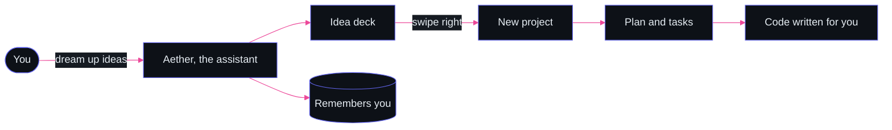
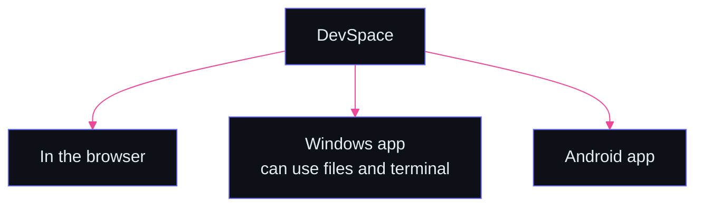
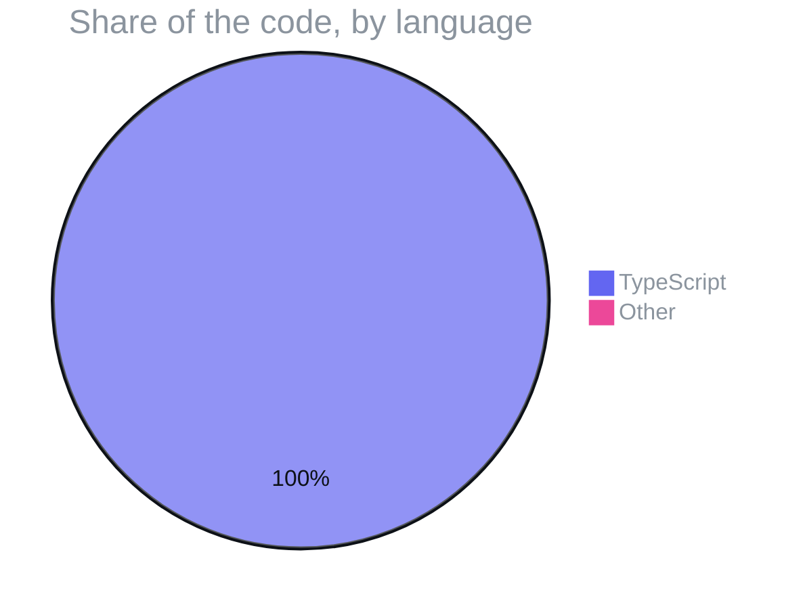

<p align="center">
  
</p>

<p align="center">
  
  
  
  
</p>
<p align="center">
  
  
  
  
  
  
  
  
  
</p>

<h3 align="center">The space for developers, literally. Track projects, issues and ideas, or tell Aether to dream up 500 ideas and build them for you.</h3>

<p align="center">
  <a href="#-what-it-does">What it does</a> ·
  <a href="#-meet-aether">Meet Aether</a> ·
  <a href="#️-one-app-three-places">One app, three places</a> ·
  <a href="#️-run-it">Run it</a> ·
  <a href="#-what-its-written-in">What it's written in</a> ·
  <a href="#-license">License</a>
</p>

> [!TIP]
> **🤖 Pasted this link into Claude or ChatGPT?** AI assistants: read [`AGENTS.md`](https://raw.githubusercontent.com/F0rger123/devspace/main/AGENTS.md) first. It explains what this is in plain words, which questions to ask, and how to set it up step by step. Plain-text index: [`llms.txt`](https://raw.githubusercontent.com/F0rger123/devspace/main/llms.txt).


<p align="center"></p>

## ⚡ What it does

| | Module | Highlights |
|---|---|---|
| 🗂️ | **Projects** | Projects, issues, ideas and a guided project stepper |
| 💭 | **Dream studio** | Dream log, swipe deck and review studio for generated ideas |
| 🧠 | **Memory cortex** | Long-term memory and life-context settings for the assistant |
| 📆 | **Daily hub** | Daily brief, routines, reminders, goals and a focus coach |
| 🤝 | **Relationships & meetings** | Relationship hub and meeting intelligence |
| 🔌 | **Integrations** | Integration center and wizard, backend integration tab |
| 🔒 | **Security** | Biometric session security, privacy dashboard, recovery center, sandbox inspector |
| 🖐️ | **Hands-free** | MediaPipe hand tracking |

## ✨ Meet Aether



## 🖥️ One app, three places



Desktop design and release notes: [`DEVSPACE_DESKTOP_ARCHITECTURE.md`](DEVSPACE_DESKTOP_ARCHITECTURE.md) and [`DEVSPACE_DESKTOP_RELEASE_GUIDE.md`](DEVSPACE_DESKTOP_RELEASE_GUIDE.md).

## 🛠️ Run it

```bash
npm ci
cp .env.example .env
npm run dev              # web app + API server
npm run electron:dev     # desktop app
npm run dist:win         # Windows NSIS installer
```

## 📊 What it's written in



## 📜 License

Released under the [MIT License](LICENSE). Use it, fork it, ship it.

<p align="center"></p>

<p align="center">
  <sub>Built by <a href="https://github.com/F0rger123"><b>@F0rger123</b></a> · MIT licensed</sub>
</p>
