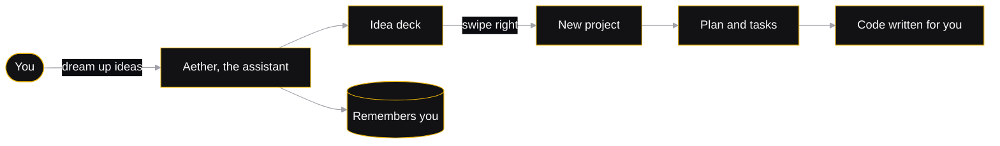
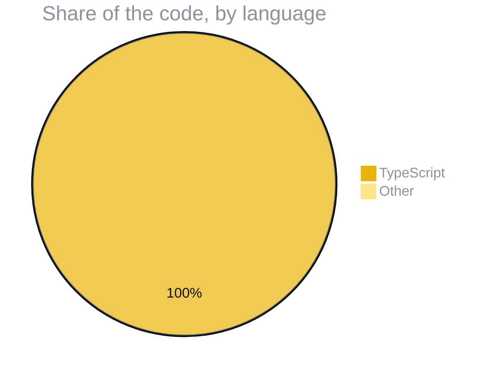

<p align="center">
  
</p>

<p align="center">
  
  
  
  
</p>
<p align="center">
  
  
  
  
  
  
  
  
  
</p>

<h3 align="center">The space for developers, literally. Track projects, issues and ideas, or tell Aether to dream up 500 ideas and build them for you.</h3>

<p align="center">
  <a href="#-run-it">run it</a> ·
  <a href="#-whats-inside">what's inside</a> ·
  <a href="#-meet-aether">meet aether</a> ·
  <a href="#-one-app-three-places">one app, three places</a> ·
  <a href="#-written-in">written in</a>
</p>

> [!TIP]
> **🤖 Pasted this link into Claude or ChatGPT?** AI assistants: read [`AGENTS.md`](https://raw.githubusercontent.com/F0rger123/devspace/main/AGENTS.md) first. It explains what this is in plain words, which questions to ask, and how to set it up step by step. Plain-text index: [`llms.txt`](https://raw.githubusercontent.com/F0rger123/devspace/main/llms.txt).


<p align="center"></p>

## `$` run it

```bash
npm ci
cp .env.example .env     # add your own keys here, never commit this file
npm run dev              # web app + API server on http://localhost:3000
npm run electron:dev     # desktop app
npm run dist:win         # Windows installer
```

## `~/` what's inside

<table>
  <tr>
    <td width="50%"><b>🗂️ Projects</b><br><sub>Projects, issues, ideas and a guided project stepper.</sub></td>
    <td width="50%"><b>💭 Dream studio</b><br><sub>A dream log, a swipe deck and a review studio for generated ideas.</sub></td>
  </tr>
  <tr>
    <td><b>🧠 Memory cortex</b><br><sub>Long-term memory and life context, so Aether remembers how you work.</sub></td>
    <td><b>📆 Daily hub</b><br><sub>Daily brief, routines, reminders, goals and a focus coach.</sub></td>
  </tr>
  <tr>
    <td><b>🤝 People & meetings</b><br><sub>A relationship hub and meeting notes that turn into tasks.</sub></td>
    <td><b>🔌 Integrations</b><br><sub>An integration center and wizard for the tools you already use.</sub></td>
  </tr>
  <tr>
    <td><b>🔒 Security</b><br><sub>Biometric sessions, a privacy dashboard, recovery and a sandbox inspector.</sub></td>
    <td><b>🖐️ Hands-free</b><br><sub>Control the workspace with hand gestures from your camera.</sub></td>
  </tr>
</table>

## `>` meet aether



## `::` one app, three places

| | 🌐 Browser | 🪟 Windows | 🤖 Android |
|---|---|---|---|
| **Start it** | `npm run dev` | `npm run electron:dev` | Capacitor build in `android/` |
| **Extra powers** | Works anywhere | Can use your files and terminal | Takes the workspace with you |
| **Ship it** | Any Node host | `npm run dist:win` installer | Android Studio |

Desktop design and release notes: [`DEVSPACE_DESKTOP_ARCHITECTURE.md`](DEVSPACE_DESKTOP_ARCHITECTURE.md) and [`DEVSPACE_DESKTOP_RELEASE_GUIDE.md`](DEVSPACE_DESKTOP_RELEASE_GUIDE.md).

## `#` written in



## `©` license

Released under the [MIT License](LICENSE). Use it, fork it, ship it.

<p align="center"></p>

<p align="center">
  <sub>Built by <a href="https://github.com/F0rger123"><b>@F0rger123</b></a> · MIT licensed</sub>
</p>
