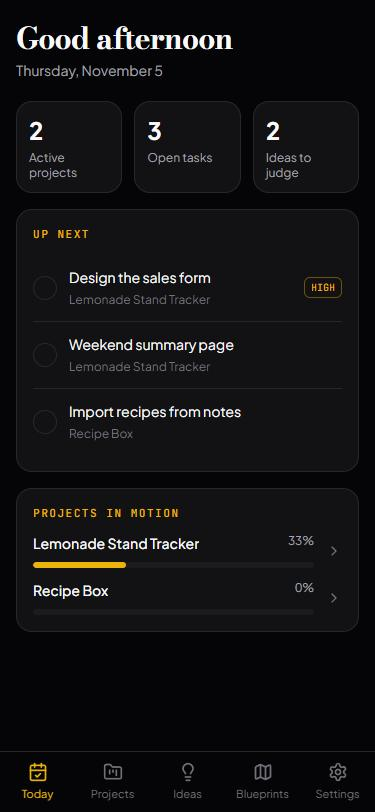
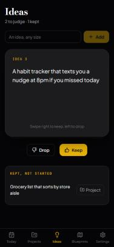
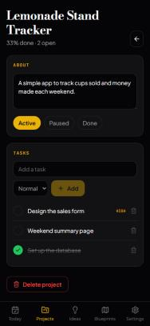
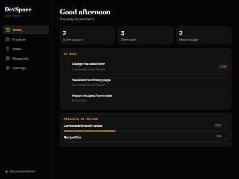
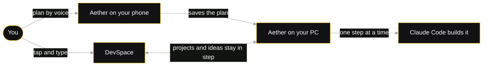

<p align="center">
  
</p>

<p align="center">
  
  
  
  
</p>

> [!TIP]
> **AI agents: start here.** Pasted this link into Claude or ChatGPT? Read
> [`AGENTS.md`](https://raw.githubusercontent.com/F0rger123/devspace/v2/AGENTS.md) first. Plain-text index:
> [`llms.txt`](https://raw.githubusercontent.com/F0rger123/devspace/v2/llms.txt).

<h3 align="center">Your projects, tasks and ideas, made for your phone first. Aether plans the big ones with you and has Claude Code build them.</h3>

<p align="center">
  
  
  
</p>
<p align="center"></p>
<p align="center"><sub>Screenshots use made-up demo data.</sub></p>

## `~/` what's inside

| Page | What it does |
|---|---|
| **Today** | What to do next across your active projects, most important first, and how far each one is |
| **Projects** | Every project with its tasks, progress and status (active, paused, done) |
| **Ideas** | Drop ideas in, swipe right to keep and left to drop, turn kept ones into projects |
| **Blueprints** | Big plans made by voice with Aether, and how far Claude Code got building them |
| **Settings** | Link Aether, download a copy of your data |

## `>` how it fits with Aether



## `↓` download it

**DevSpace for Windows:** grab **DevSpace Setup** from [Releases](https://github.com/F0rger123/devspace/releases).
With [Aether for Windows](https://github.com/F0rger123/aether-agent) installed it links to Aether by itself.

## `$` run it

```bash
npm install
npm run dev      # http://localhost:5180, also reachable from your phone on the same Wi-Fi
npm run build    # production build in dist/
npm run app      # the Windows app
npm run dist     # the Windows installer, in release/
```

Your data is kept in the browser. Link the [Aether PC agent](https://github.com/F0rger123/aether-agent)
in Settings and it's kept on your PC too, where Aether on your phone can see it.

The first DevSpace (built in Google AI Studio) is on the `main` branch. This `v2` branch is the
rebuild: only the parts that really work, mobile first.
